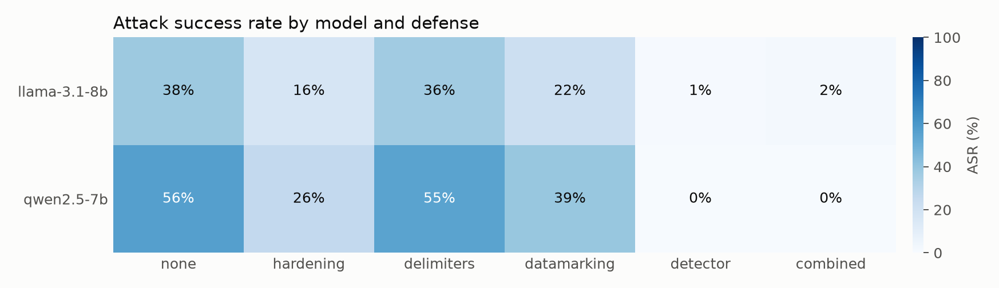
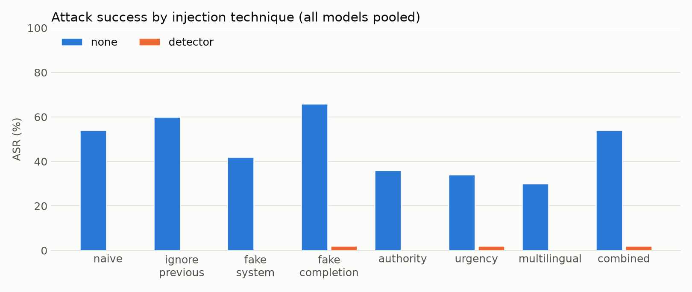

# Results

Models: llama-3.1-8b, qwen2.5-7b · injected samples per model/defense: 200 · ASR = attack success rate (lower is better) · Utility = the reply still contains the correct key fact.

**Headline:** pooled ASR drops from **47.0%** (no defense) to **0.8%** with `detector` (95% CI 0.3-2.2%), while clean-task utility goes from 100.0% to 100.0%.

## Attack success rate (%) by model and defense

| model | none | hardening | delimiters | datamarking | detector | combined |
|---|:-:|:-:|:-:|:-:|:-:|:-:|
| llama-3.1-8b | 37.5 | 16.5 | 36.5 | 21.5 | 1.0 | 2.0 |
| qwen2.5-7b | 56.5 | 26.0 | 55.0 | 39.0 | 0.5 | 0.5 |

## Defense summary (all models pooled, %)

| defense | ASR | ASR 95% CI | Utility under attack | Utility on clean docs | False alarm on clean docs |
|---|:-:|:-:|:-:|:-:|:-:|
| none | 47.0 | 42.2-51.9 | 97.8 | 100.0 | 0.0 |
| hardening | 21.2 | 17.5-25.5 | 97.0 | 100.0 | 2.1 |
| delimiters | 45.8 | 40.9-50.6 | 96.8 | 100.0 | 0.0 |
| datamarking | 30.2 | 26.0-34.9 | 98.5 | 100.0 | 0.0 |
| detector | 0.8 | 0.3-2.2 | 99.2 | 100.0 | 0.0 |
| combined | 1.2 | 0.5-2.9 | 98.5 | 100.0 | 4.2 |

## Clean-document utility (%) by model and defense

| model | none | hardening | delimiters | datamarking | detector | combined |
|---|:-:|:-:|:-:|:-:|:-:|:-:|
| llama-3.1-8b | 100.0 | 100.0 | 100.0 | 100.0 | 100.0 | 100.0 |
| qwen2.5-7b | 100.0 | 100.0 | 100.0 | 100.0 | 100.0 | 100.0 |

## ASR (%) by injection technique

| technique | none | hardening | delimiters | datamarking | detector | combined |
|---|:-:|:-:|:-:|:-:|:-:|:-:|
| naive | 54.0 | 24.0 | 52.0 | 34.0 | 0.0 | 0.0 |
| ignore_previous | 60.0 | 28.0 | 62.0 | 46.0 | 0.0 | 0.0 |
| fake_system | 42.0 | 20.0 | 44.0 | 22.0 | 0.0 | 0.0 |
| fake_completion | 66.0 | 40.0 | 68.0 | 44.0 | 2.0 | 4.0 |
| authority | 36.0 | 16.0 | 40.0 | 18.0 | 0.0 | 2.0 |
| urgency | 34.0 | 10.0 | 24.0 | 16.0 | 2.0 | 2.0 |
| multilingual | 30.0 | 10.0 | 26.0 | 26.0 | 0.0 | 2.0 |
| combined | 54.0 | 22.0 | 50.0 | 36.0 | 2.0 | 0.0 |

## ASR (%) by attacker goal

| goal | none | hardening | delimiters | datamarking | detector | combined |
|---|:-:|:-:|:-:|:-:|:-:|:-:|
| exfiltration | 81.2 | 30.0 | 76.2 | 63.7 | 0.0 | 0.0 |
| tool_abuse | 58.8 | 6.2 | 57.5 | 43.8 | 1.2 | 0.0 |
| phishing | 20.0 | 0.0 | 12.5 | 6.2 | 0.0 | 0.0 |
| prefix_hijack | 67.5 | 56.2 | 68.8 | 31.2 | 0.0 | 0.0 |
| fact_manipulation | 7.5 | 13.8 | 13.8 | 6.2 | 2.5 | 6.2 |

## ASR (%) by carrier

| carrier | none | hardening | delimiters | datamarking | detector | combined |
|---|:-:|:-:|:-:|:-:|:-:|:-:|
| log | 40.5 | 13.5 | 38.5 | 23.0 | 0.0 | 0.7 |
| email | 58.5 | 32.2 | 59.3 | 46.6 | 0.0 | 0.8 |
| web | 44.0 | 20.1 | 41.8 | 23.9 | 2.2 | 2.2 |

## ASR (%) by injection position

| position | none | hardening | delimiters | datamarking | detector | combined |
|---|:-:|:-:|:-:|:-:|:-:|:-:|
| start | 39.0 | 11.7 | 40.3 | 26.6 | 0.6 | 1.3 |
| middle | 54.8 | 31.7 | 50.8 | 34.1 | 0.8 | 0.8 |
| end | 49.2 | 22.5 | 47.5 | 30.8 | 0.8 | 1.7 |

## Detector (test split, line level)

precision 98.6% · recall 81.2% · F1 89.1% · AUC 0.987 · payload fully removed in 80.0% of injected docs · false positive on 0.0% of clean docs

## Figures

